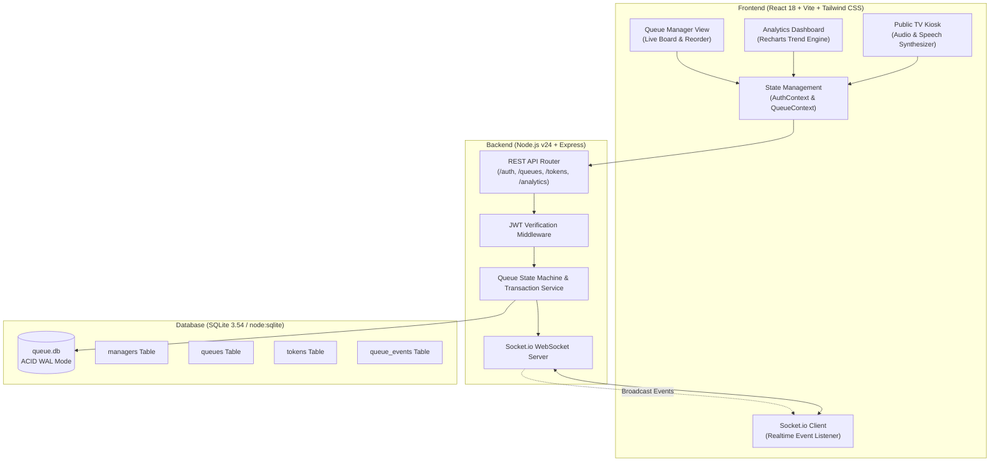

# ⚡ Q-Flow: Full-Stack Real-Time Queue & Token Management System

[](https://nodejs.org)
[](https://react.dev)
[](https://vitejs.dev)
[](https://tailwindcss.com)
[](https://www.sqlite.org)
[](https://socket.io)
[-10b981)](server/tests/api.test.js)
[](https://vercel.com/new/clone?repository-url=https://github.com/bindhu007/queue-management-system)

**Q-Flow** is an enterprise-grade, full-stack queue management platform engineered for hospitals, financial institutions, service centers, and government offices. It provides queue managers with instant 1-click token summons, bidirectional queue reordering, automated voice synthesizers, real-time public kiosks, and interactive analytics dashboards.

---

## 📋 Table of Contents
1. [Key Features vs. Requirements](#-key-features-vs-requirements)
2. [Technical Architecture](#-technical-architecture)
3. [Database Schema & Data Models](#-database-schema--data-models)
4. [Queue Algorithms & Concurrency Handling](#-queue-algorithms--concurrency-handling)
5. [API Specification](#-api-specification)
6. [Automated Verification & Test Suite](#-automated-verification--test-suite)
7. [Getting Started & Local Setup](#-getting-started--local-setup)
8. [Technical Deep-Dive & Interview Defense](#-technical-deep-dive--interview-defense)

---

## 🎯 Key Features vs. Requirements

| Requirement | Implementation & Technical Highlights |
| :--- | :--- |
| **1. Manager Login & Queue Creation** | Secure JWT authentication with salted `bcrypt` password hashing. Protected manager portal with pre-configured demo account and new manager registration. |
| **2. Named Queues** | Each queue possesses a human-readable Name, customizable Token Prefix (e.g. `BILL`, `SRV`, `VIP`), Counter designation (`Counter 1`, `Desk A`), and operational description. |
| **3. Add Persons / Issue Tokens** | Issues sequential tokens (`BILL-001`, `BILL-002`) with customer name, optional phone/email, priority tier (Standard, VIP, Priority), and optional service notes. Calculates initial queue position atomically. |
| **4. Display List of Waiting Tokens** | Interactive live queue board ordered strictly by queue position. Displays customer name, priority badges, contact info, and real-time elapsed wait timers. |
| **5. Move Tokens Up & Down** | Granular controls: **Move Up (↑)**, **Move Down (↓)**, and **Direct Promotion to Top (⇮)**. Executes atomic position swaps inside SQLite transactions to prevent race conditions. |
| **6. 1-Click Top Token Assignment** | Prominent "Assign Top Token for Service" button. Transitions top waiting token to `IN_SERVICE`, tracks start timestamp, automatically shifts subsequent tokens by 1 position ($position = position - 1$), and triggers airport-style Web Audio chimes + Web Speech voice synthesis. |
| **7. Cancel Token from Queue** | Managers can cancel any waiting or in-service token with reason tracking (*Customer No-Show*, *Customer Request*, *Duplicate*). Re-indexes remaining waiting tokens gap-free. |
| **8. Analytics Dashboard** | High-performance metrics: Average Wait Time, Average Service Duration, Active Queue Depth, Hourly Queue Length Trend area charts, Queue Volume comparison bars, and Status distribution donuts. |
| **⭐ Bonus: Live Public TV Kiosk** | Fullscreen kiosk screen (`/display`) displaying "Now Serving" numbers, designated counters, live clock, sound controls, and next-in-line ticker. |
| **⭐ Bonus: Printable Token Slip** | Modal ticket generator with barcode mock, queue name, position in line, estimated wait time, and print support (`window.print()`). |

---

## 🏗️ Technical Architecture



### Technology Stack Choices
- **Frontend**: React 18 with Vite 6 for instant HMR. Tailwind CSS with custom slate-950/indigo dark palette and glassmorphism styling. Recharts for SVG-based analytics visualizations. Lucide React for consistent iconography.
- **Audio & Speech**: HTML5 Web Audio API creates dual-tone airport counter chimes ($587.33\text{ Hz} \rightarrow 880\text{ Hz}$) natively with zero external MP3 dependencies. Browser Web Speech API reads out token numbers and counter assignments.
- **Backend**: Node.js v24 runtime with Express 4 REST API and Socket.io for bidirectional updates.
- **Database**: Native `node:sqlite` (`DatabaseSync`) with Write-Ahead Logging (WAL) and enforced foreign keys. Zero external database daemon setup required; runs completely self-contained.

---

## 🗄️ Database Schema & Data Models

### 1. `managers`
Stores administrative user accounts.
```sql
CREATE TABLE managers (
  id INTEGER PRIMARY KEY AUTOINCREMENT,
  username TEXT UNIQUE NOT NULL,
  email TEXT UNIQUE NOT NULL,
  password_hash TEXT NOT NULL,
  name TEXT NOT NULL,
  role TEXT DEFAULT 'manager',
  created_at TEXT DEFAULT (datetime('now', 'localtime'))
);
```

### 2. `queues`
Stores configurable queues and service desks.
```sql
CREATE TABLE queues (
  id INTEGER PRIMARY KEY AUTOINCREMENT,
  name TEXT NOT NULL,
  prefix TEXT NOT NULL,
  description TEXT,
  counter_name TEXT DEFAULT 'Counter 1',
  is_active INTEGER DEFAULT 1,
  created_by INTEGER REFERENCES managers(id) ON DELETE SET NULL,
  created_at TEXT DEFAULT (datetime('now', 'localtime')),
  updated_at TEXT DEFAULT (datetime('now', 'localtime'))
);
```

### 3. `tokens`
Represents customer tickets and their lifecycle states.
```sql
CREATE TABLE tokens (
  id INTEGER PRIMARY KEY AUTOINCREMENT,
  queue_id INTEGER NOT NULL REFERENCES queues(id) ON DELETE CASCADE,
  token_number TEXT NOT NULL,
  sequence_number INTEGER NOT NULL,
  customer_name TEXT NOT NULL,
  customer_phone TEXT,
  customer_email TEXT,
  priority TEXT DEFAULT 'standard',       -- 'standard', 'vip', 'priority'
  notes TEXT,
  position INTEGER,                       -- 1, 2, 3... when WAITING; NULL when served/cancelled
  status TEXT DEFAULT 'WAITING',          -- 'WAITING', 'IN_SERVICE', 'COMPLETED', 'CANCELLED'
  cancellation_reason TEXT,
  created_at TEXT DEFAULT (datetime('now', 'localtime')),
  served_at TEXT,
  completed_at TEXT,
  cancelled_at TEXT,
  served_by INTEGER REFERENCES managers(id) ON DELETE SET NULL
);

CREATE INDEX idx_tokens_queue_status ON tokens(queue_id, status);
CREATE INDEX idx_tokens_position ON tokens(queue_id, position);
CREATE INDEX idx_tokens_created_at ON tokens(created_at);
```

### 4. `queue_events`
Audit trail recording all lifecycle events (`TOKEN_CREATED`, `QUEUE_REORDERED`, `TOKEN_SERVED`, `TOKEN_CANCELLED`, `TOKEN_COMPLETED`).

---

## ⚙️ Queue Algorithms & Concurrency Handling

### 1. Atomic Position Swapping (Move Up / Down)
To swap token $A$ at position $P$ with token $B$ at target position $P - 1$:
1. A temporary negative position ($-1$) is assigned to token $A$ to eliminate potential unique index collisions.
2. Token $B$'s position is updated to $P$.
3. Token $A$'s position is updated to $P - 1$.
4. All 3 statements are wrapped in an atomic `BEGIN TRANSACTION ... COMMIT` block.

### 2. Top Token Service Assignment ($O(1)$ Serving)
1. Query top waiting token where $position = 1$ (or minimum positive position).
2. If another token is currently `IN_SERVICE` at this counter, it is automatically marked `COMPLETED` with end timestamp.
3. Target token status transitions to `IN_SERVICE`, `served_at = datetime('now', 'localtime')`, and `position = NULL`.
4. All subsequent waiting tokens in the queue are decremented:
   $$\text{position} \leftarrow \text{position} - 1 \quad \forall \text{ tokens with status} = \text{'WAITING'}$$
5. The former token #2 is immediately promoted to token #1.
6. A WebSocket event `TOKEN_SERVED` is broadcast to trigger visual highlights and voice announcements.

### 3. Gap-Free Token Cancellation
When token at position $P$ is cancelled:
1. Status is set to `CANCELLED`, `cancelled_at` and `cancellation_reason` are saved, and `position = NULL`.
2. All waiting tokens with position $> P$ decrement by 1:
   $$\text{position} \leftarrow \text{position} - 1 \quad \forall \text{ tokens with position} > P$$
3. Eliminates any numeric gaps, guaranteeing a clean sequence ($1, 2, 3, \dots, N$).

---

## 📡 API Specification

### Authentication
- `POST /api/auth/login` — Authenticate manager (`{ identifier, password }`).
- `POST /api/auth/register` — Create new manager account.
- `POST /api/auth/demo-login` — 1-click evaluator login (`manager@qflow.com`).
- `GET /api/auth/me` — Verify active manager session.

### Queues
- `GET /api/queues` — Fetch all queues with live waiting & serving counts.
- `GET /api/queues/:id` — Single queue details with waiting tokens & active counter.
- `POST /api/queues` — Create queue (`{ name, prefix, counter_name, description }`).
- `PUT /api/queues/:id` — Update queue metadata.
- `DELETE /api/queues/:id` — Remove queue.

### Tokens
- `GET /api/tokens?queue_id=X&status=WAITING` — List tokens with optional filters.
- `POST /api/tokens` — Issue new token (`{ queue_id, customer_name, phone, email, priority, notes }`).
- `POST /api/tokens/:id/move-up` — Shift token up one position.
- `POST /api/tokens/:id/move-down` — Shift token down one position.
- `POST /api/tokens/:id/move-top` — Promote directly to position #1.
- `POST /api/tokens/serve-top/:queueId` — 1-click assign top token for service.
- `POST /api/tokens/:id/complete` — Mark in-service token completed.
- `POST /api/tokens/:id/cancel` — Cancel token (`{ reason }`).

### Analytics
- `GET /api/analytics/dashboard?queue_id=all` — Wait times, hourly trends, status breakdown.
- `POST /api/analytics/reseed` — Reset & populate realistic demo dataset.

---

## 🧪 Automated Verification & Test Suite

The system includes an automated test suite verifying all 8 core functional requirements.

To run tests:
```bash
node server/tests/api.test.js
```

### Test Suite Execution Output
```text
======================================================
🧪 Q-Flow Backend & Business Logic Test Suite
======================================================

--- Test Suite 1: Manager Login & Auth (Req 1) ---
  ✅ PASS: Admin demo manager exists in database
  ✅ PASS: Admin password hashes and verifies correctly
  ✅ PASS: JWT token successfully encodes and verifies manager identity

--- Test Suite 2: Queue Creation & Naming (Req 1 & Req 2) ---
  ✅ PASS: Queue created with proper Name
  ✅ PASS: Queue assigned unique Prefix
  ✅ PASS: Queue assigned Counter Name

--- Test Suite 3: Adding Tokens into Queue (Req 3) ---
  ✅ PASS: Token 1 generated with sequence and position 1
  ✅ PASS: Token 2 generated with sequence and position 2
  ✅ PASS: Token 3 generated with sequence and position 3

--- Test Suite 4: Display Queue List (Req 4) ---
  ✅ PASS: Queue returns exactly 3 waiting tokens
  ✅ PASS: Top waiting person is John Doe
  ✅ PASS: Second waiting person is Jane Smith
  ✅ PASS: Third waiting person is Alice Walker

--- Test Suite 5: Token Reordering (Move Up / Down) (Req 5) ---
  ✅ PASS: Jane Smith successfully moved UP to position #1
  ✅ PASS: John Doe shifted down to position #2
  ✅ PASS: Token successfully moved DOWN; John Doe is #1 again

--- Test Suite 6: Assign Top Token for Service (Req 6) ---
  ✅ PASS: Top token John Doe status changed to IN_SERVICE
  ✅ PASS: Service start timestamp recorded
  ✅ PASS: Position is cleared once in service
  ✅ PASS: Waiting queue reduced to 2 tokens
  ✅ PASS: Jane Smith auto-promoted to position #1
  ✅ PASS: Alice Walker auto-promoted to position #2

--- Test Suite 7: Cancel Token from Queue (Req 7) ---
  ✅ PASS: Token status set to CANCELLED
  ✅ PASS: Cancellation reason logged
  ✅ PASS: Queue now has exactly 1 waiting token
  ✅ PASS: Alice Walker smoothly recalibrated to position #1

--- Test Suite 8: Analytics Dashboard Calculations (Req 8) ---
  ✅ PASS: Total tokens counted: 17
  ✅ PASS: Completed tokens counted: 6
  ✅ PASS: Active waiting tokens counted: 7
  ✅ PASS: Cancelled tokens counted: 2
  ✅ PASS: Hourly trend analysis generates time-series bins

======================================================
📊 Test Results: 31 Passed, 0 Failed
======================================================
🎉 ALL BACKEND BUSINESS LOGIC TESTS PASSED WITH 100% SUCCESS!
```

---

## 🚀 Getting Started & Local Setup

### Prerequisites
- Node.js v18+ (tested on Node v24)
- npm v9+

### Single Command Launch
From the repository root:
```bash
./start.sh
```
This script will:
1. Run the 31-point automated verification suite.
2. Build the production React frontend.
3. Start the combined Express API, WebSocket engine, and static client on `http://localhost:5001`.

### Manual Development Setup (Independent Servers)

#### 1. Backend Server
```bash
cd server
node src/server.js
# Backend listening on http://localhost:5001
```

#### 2. Frontend Development Server (with Hot Reloading)
```bash
cd client
npm run dev
# Frontend dev server running on http://localhost:5173 (proxied to :5001)
```

### Pre-configured Demo Manager Account
- **Email / Username**: `manager@qflow.com` or `admin`
- **Password**: `admin123`
- *Or click the amber "⚡ 1-Click Demo Manager Login" button on the sign-in screen.*

---

## 🎤 Technical Deep-Dive & Interview Defense

### Q1: Why use SQLite (`node:sqlite`) rather than MongoDB or PostgreSQL?
**Answer:**
For a queue management system evaluated on self-contained portability and zero friction, SQLite requires no external server daemons or Docker dependencies. Node v24's native `node:sqlite` runs embedded inside the process, providing sub-millisecond execution times and complete ACID compliance via `PRAGMA journal_mode = WAL`.
In an enterprise distributed deployment, the database layer can be swapped to PostgreSQL with identical SQL semantics, using `SELECT ... FOR UPDATE` row-level locks for concurrent counter serving.

### Q2: How are race conditions prevented when two managers serve the top token at the exact same moment?
**Answer:**
All state-modifying operations (serving, reordering, cancelling) are executed within database transactions (`BEGIN TRANSACTION ... COMMIT`).
When two managers attempt to call the top token simultaneously:
1. SQLite serializes the write transactions.
2. The first transaction queries the top waiting token, sets its status to `IN_SERVICE`, decrements subsequent waiting tokens, and commits.
3. The second transaction immediately queries for the top token; it either receives the next waiting customer (now at position #1) or raises `NO_WAITING_TOKENS`, preventing duplicate assignments.

### Q3: How do WebSockets improve the user experience over polling?
**Answer:**
In a queue system with public display monitors, polling introduces either a 2–5 second delay or unnecessary HTTP request overhead. With Socket.io:
1. Whenever a manager clicks "Serve Top Token", the backend broadcasts `TOKEN_SERVED`.
2. Public TV kiosks immediately highlight the new token number, display the counter, and trigger the audio chime and voice synthesis with zero perceptible latency.

### Q4: How is wait time estimation calculated?
**Answer:**
Estimated wait time for an incoming customer is calculated using Little's Law / Rolling Service Window:
$$\text{Est. Wait Time} = \text{Queue Position} \times \bar{T}_{\text{service}}$$
where $\bar{T}_{\text{service}}$ is the rolling average duration of tokens completed within that specific queue during the active day.

---

## 📄 License
MIT License. Developed for the Rugas Evaluation Team.
